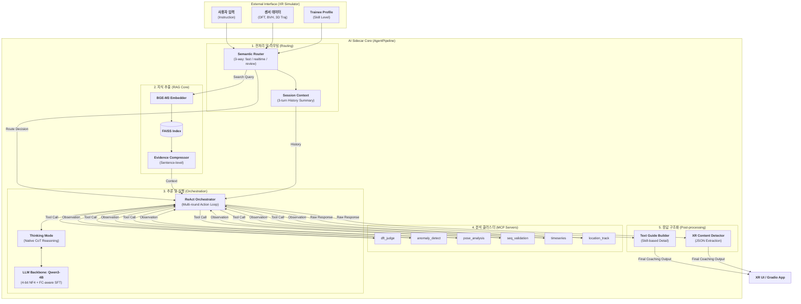

# 선박 도장 AI Co-Pilot 통합 기술 설계서 (Current Dev State)

**버전:** v1.6.5 (Stable Prototype)  
**최근 업데이트:** 2026-03-13  
**대상 하드웨어:** NVIDIA RTX 4080 (16GB VRAM)  
**가동 모델:** Qwen3-4B (4-bit NF4 Quantized)

---

## 1. 시스템 설계 개요 (Introduction)

본 시스템은 선박 도장 작업의 숙련도 향상을 위해 설계된 **Agentic AI Co-Pilot** 프로토타입이다. 시뮬레이터 외부에서 독립적으로 작동하는 **Sidecar AI Core** 구조를 취하며, 언어 모델의 추론 능력(LLM)과 6종의 정밀 분석 도구(MCP)를 결합하여 실시간 코칭을 제공한다. RTX 4080 환경에서 시뮬레이터와 동시 가동이 가능하도록 경량 모델 최적화 및 지능형 라우팅 기술을 적용하였다.

---

## 2. 시스템 아키텍처 (System Architecture)

---

## 3. 핵심 기술 사양 (Technical Specifications)

### 3.1 3-way Semantic Router (`agent_pipeline.py`)
입력 텍스트와 환경 데이터 유무에 따라 3가지 처리 경로로 자동 분기하여 자원을 최적화한다.
- **fast**: 단순 지식 질의. 도구 호출 생략 (Max Round: 1).
- **training_realtime**: 순서/이상탐지 등 즉각적 대응 필요 시 (Max Round: 3).
- **training_review**: 자세/추세분석 등 심층 분석 필요 시 (Max Round: 5).

### 3.2 지식 엔진 및 증거 압축 (RAG & Compression)
- **Context Window**: 4,096 토큰 (RTX 4080 VRAM 안정성 우선).
- **Evidence Compression**: 검색된 청크에서 질문 키워드와 겹치는 핵심 문장만 추출하여 프롬프트 길이를 80% 절감.
- **Embedding**: BGE-M3 (1024d) + FAISS HNSW32 인덱스 (10,829 청크).

### 3.3 ReAct Orchestrator & Tool Calling
- **Native FC**: Qwen3의 `<tool_call>` XML 포맷 파싱 및 MCP 서버(FastAPI) 연동.
- **Error Handling**: Malformed JSON 발생 시 해당 도구 Skip 및 텍스트 추론 폴백(Iteration 8 사양).
- **Session Memory**: 최근 3턴의 대화 요약을 프롬프트에 주입하는 Sliding Window 방식.

### 3.4 MCP Server Cluster (6-Tools)
- **dft_judge**: 90/10 규정 및 평균 두께 합부 판정 (`Actual`).
- **timeseries**: 세션 내 작업 속도/거리 트렌드 분석 및 상태 유지 (`Actual`).
- **기타 4종**: `pose_estimation`, `anomaly_detection`, `sequence_validation`, `location_tracking` (`Stub/Fixture`).

---

## 4. 하드웨어 자원 배분 설계 (RTX 4080)

| 컴포넌트 | VRAM 점유 (실측/예상) | 비고 |
|---|---|---|
| **LLM Engine (4B)** | **~4.5 GB** | 4-bit NF4 + KV Cache |
| **Knowledge (RAG)** | ~2.0 GB | BGE-M3 + Reranker |
| **Middleware & MCP** | ~1.5 GB | 6종 FastAPI 서버군 |
| **System/Unity Reserve** | ~8.0 GB | XR 시뮬레이터 및 센서 데이터 처리 여유분 |
| **Total** | **~16.0 GB** | **단일 GPU 내 시뮬레이터-AI 병행 가동** |

---
*본 설계서는 현재 구현된 Qwen3-4B 기반 프로토타입의 기술적 실체를 담은 문서이다.*
