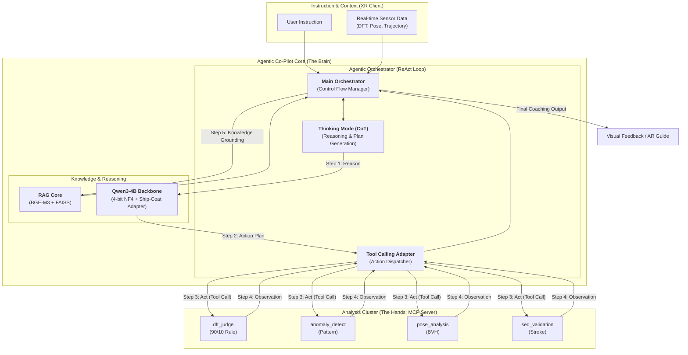

# 선박 도장 AI Co-Pilot 아키텍처 및 상세 설계서 (Design Specification)

**버전:** v1.3 (Orchestration Centric)  
**최근 업데이트:** 2026-03-12  
**핵심 설계:** ReAct Loop, Native Tool Calling, MCP Server Cluster  
**대상 하드웨어:** NVIDIA RTX 4080 (16GB VRAM)

---

## 1. 시스템 설계 철학 (Design Philosophy)

본 시스템은 **"추론하는 뇌(LLM)"**와 **"계산하는 손(MCP Tools)"**의 완전한 분리 및 협업을 지향한다.
- **Agent Orchestration**: 사용자의 모호한 명령을 구체적인 분석 단계로 분해하고 실행 전반을 관리한다.
- **Native Tool Calling**: Qwen3의 내장 기능을 활용하여 복잡한 수치 데이터를 도구에 전달하고, 그 결과를 다시 추론 문맥에 통합(Grounding)한다.

---

## 2. 에이전트 중심 아키텍처 (Agentic Architecture)

오케스트레이터(`AgentPipeline`)가 중심이 되어 **지식 검색(RAG)**과 **수치 분석(MCP)**을 유기적으로 조율하는 구조이다.



---

## 3. 핵심 모듈별 설계 명세

### 3.1 Agentic Orchestration (`agent_pipeline.py`)
- **ReAct Loop Control**: 사용자의 질문이 실시간 데이터 분석을 요구할 경우, 최대 5회의 반복 라운드를 통해 '추론-행동-관찰' 과정을 수행한다.
- **Semantic Routing**: 입력 텍스트와 환경 데이터를 분석하여 즉시 답변(Fast Path)과 심층 분석(Deep Path) 경로를 결정한다.
- **Context Aggregation**: 여러 MCP 도구의 분석 결과와 RAG의 지식 청크를 하나의 일관된 문맥으로 병합하여 LLM이 최종 판단을 내릴 수 있도록 지원한다.
- **Evidence Compression**: RAG 검색 결과에서 질문과 직접적으로 관련된 문장만 추출하여 프롬프트의 효율성을 극대화한다.

### 3.2 Tool Calling & Protocol (`tool_calling_adapter.py`)
- **Native FC 통합**: Qwen3의 `<tool_call>` XML 형식을 정규식으로 파싱하고, 각 도구의 JSON Schema에 맞춰 MCP 엔드포인트로 디스패치한다.
- **Multi-turn State**: 각 라운드에서 발생한 도구 호출 이력과 결과를 대화 기록(`messages`)에 순차적으로 주입하여 모델이 이전 행동을 기억하게 한다.
- **Robust Error Handling**: 
    - **Graceful Skip**: 특정 도구의 결과가 Malformed JSON일 경우, 해당 도구만 스킵하고 나머지 결과를 바탕으로 추론을 이어간다.
    - **Fallback Reasoning**: 도구 호출이 실패하더라도 시스템 중단 없이 RAG 지식 기반의 텍스트 응답으로 전환한다.

### 3.3 Deterministic Analysis (MCP Servers)
모든 도구는 FastAPI 기반의 독립 서버로 구현되어 LLM의 '계산 오차'를 제거한다.
- **dft_judge**: 90/10 규정 로직을 포함한 실제 합부 판정 수행.
- **pose_estimation**: 숙련자 데이터와 작업자의 자세를 정량적으로 비교.
- **timeseries**: 작업 세션의 속도와 거리 추세를 통계적으로 분석.

---

## 4. 인터페이스 및 데이터 규약

### 4.1 도구 호출 프로토콜
```xml
<tool_call>
{
  "name": "pose_estimation",
  "arguments": {
    "current_pose": {"joints": {...}},
    "reference_pose": {"joints": {...}}
  }
}
</tool_call>
```

### 4.2 최종 응답 구조 (Coaching Format)
최종 응답은 작업자가 즉시 행동할 수 있는 **텍스트 가이드**와 시스템이 시각화할 수 있는 **XR JSON** 데이터로 구성된다.
```json
{
  "response": "자세를 8도 낮추세요.",
  "xr_content": {
    "xr_type": "ar_instruction",
    "steps": [{"action": "손목 각도 조정", "highlight": "wrist_r"}]
  }
}
```

---

## 5. 하드웨어 최적화 (Target: RTX 4080)

- **vLLM 폐기 및 직접 추론**: 오케스트레이션 루프의 응답성(Latency)을 최우선으로 하기 위해, 오버헤드가 큰 vLLM 대신 `Transformers` + `bitsandbytes` 직접 추론을 채택한다.
- **4-bit NF4 Quantization**: RTX 4080의 16GB VRAM 내에서 모델 가동과 대규모 센서 데이터 처리를 동시에 수행할 수 있도록 메모리 점유를 최적화한다.
- **Session Memory Optimization**: 최근 3턴의 핵심 요약만 유지하여 컨텍스트 윈도우 폭발을 방지한다.

---
*본 설계서는 에이전트의 자율적 판단과 도구 활용 능력을 극대화하여 실제 현장에서 유의미한 코칭을 제공하는 데 목적을 둔다.*
