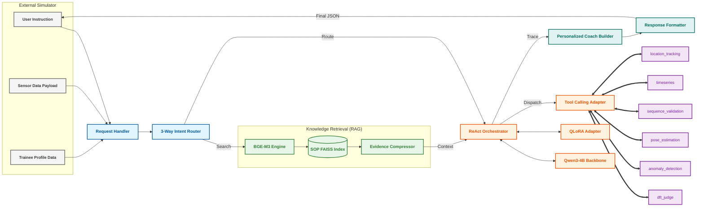

# 선박 도장 AI Co-Pilot 통합 기술 명세서 (Final Implementation Spec)

**버전:** v1.8.8 (Horizontal Modern Spec)  
**최근 업데이트:** 2026-03-13  
**대상 하드웨어:** NVIDIA RTX 4080 (16GB VRAM)  
**가동 모델:** Qwen3-4B + QLoRA Adapter (4-bit NF4)

---

## 1. 통합 시스템 아키텍처 (Integrated Architecture)

시뮬레이터(Unity)와 AI Core(Sidecar) 간의 **수평적 데이터 공정**을 정의한 에이전틱 오케스트레이션 구조이다.



---

## 2. QLoRA 미세 조정 (PEFT Strategy)

### 2.1 FC-aware SFT 데이터 믹스
에이전트의 '도구 호출 습관'과 '응답 스타일'을 고정하기 위해 433건의 정밀 데이터를 학습하였다.

| 데이터 카테고리 | 건수 | 학습 목적 |
|---|---|---|
| **Document QA** | 380건 | 도장 SOP, TDS 규정 지식 기반 정교한 답변 생성 |
| **Tool Calling (FC)** | 45건 | `<tool_call>` XML 포맷 생성 및 정확한 파라미터 구성 |
| **Multi-turn ReAct** | 8건 | 도구 분석 결과 해석 및 코칭 응답 도출 프로세스 안정화 |

### 2.2 기술적 학습 사양
- **Precision**: 4-bit NormalFloat (NF4) + bfloat16 Compute
- **Rank (r) / Alpha**: 16 / 32 (전체 파라미터의 0.81%만 학습)
- **Target Modules**: `q_proj`, `k_proj`, `v_proj`, `o_proj`, `gate_proj`, `up_proj`, `down_proj`
- **Input Length**: 4,096 Tokens (Sliding Window Session Context 지원)

---

## 3. 에이전트 작동 가이드

### 3.1 3-Way Intent Routing 전략 (`agent_pipeline.py`)
| 경로명 | 판단 기준 (Keywords) | 설정 (Max Rounds) | 응답 타겟 |
|---|---|---|---|
| **fast** | 단순 지식 질문 (용어, 규정) | 1 (Skip Tool) | < 3s |
| **training_realtime** | 순서, 이상탐지, 합부 판정 | 3 (Fast Reaction) | < 10s |
| **training_review** | 자세, 추세분석, 코칭, 리포트 | 5 (Deep Analysis) | < 30s |

### 3.2 MCP Server Cluster 상세 사양
모든 분석 도구는 FastAPI 기반의 결정론적(Deterministic) 코드로 구현된다.

| 도구명 | 엔드포인트 | 핵심 기능 | 구현 상태 |
|---|---|---|---|
| **dft_judge** | `/dft_judge/evaluate` | SSPC-PA2 90/10 룰 판정 및 위반 위치 반환 | **Actual** |
| **timeseries** | `/timeseries/{action}` | 작업 속도/거리/각도 트렌드 분석 및 상태 유지 | **Actual** |
| **anomaly_detection** | `/anomaly/detect` | 환경 및 두께 편차 기반 결함 유형 분류 | Stub |
| **pose_estimation** | `/pose/compare` | 숙련자 BVH 대비 관절 각도 편차 산출 | Stub |
| **sequence_validation** | `/seq/validate` | 구역별 Stroke 방향 및 공정 순서 검증 | Stub |
| **location_tracking** | `/loc/identify` | 3D 좌표 기반 Zone ID 및 커버리지 매핑 | Stub |

---

## 4. Simulator 통신 프로토콜 (JSON Schema)

### 4.1 Request Schema (Simulator → Co-Pilot)
```json
{
  "request_id": "uuid",
  "instruction": "현재 내 도장 상태 어때?",
  "trainee": {
    "skill_level": "beginner | intermediate | advanced",
    "language": "ko"
  },
  "environment": {"zone_id": "B-3", "temperature": 25.5},
  "sensor_data": {
    "dft_measurements": [102, 95, 110],
    "current_pose": {"wrist_r": {"pitch": 15, "yaw": 5}},
    "trajectory": [{"x": 1.0, "y": 0.5, "z": 0.8}]
  }
}
```

---

## 5. 하드웨어 자원 배분 설계 (RTX 4080 16GB)

| 구성 요소 | VRAM 점유 | 최적화 기술 |
|---|---|---|
| **LLM Engine (4B)** | **~4.5 GB** | **Base (4-bit NF4) + QLoRA Adapter (Active)** |
| **Knowledge (RAG)** | ~2.0 GB | BGE-M3 Dense Embedding + HNSW Index |
| **Middleware & MCP** | ~1.5 GB | Async FastAPI Cluster |
| **System & Reserve** | ~8.0 GB | XR Simulator 가동 및 멀티모달 확장 여유분 |

---
*본 명세서는 현재 구현된 코드를 기반으로 하며, QLoRA를 통한 도메인 적응 성과를 공식 사양으로 포함한다.*
