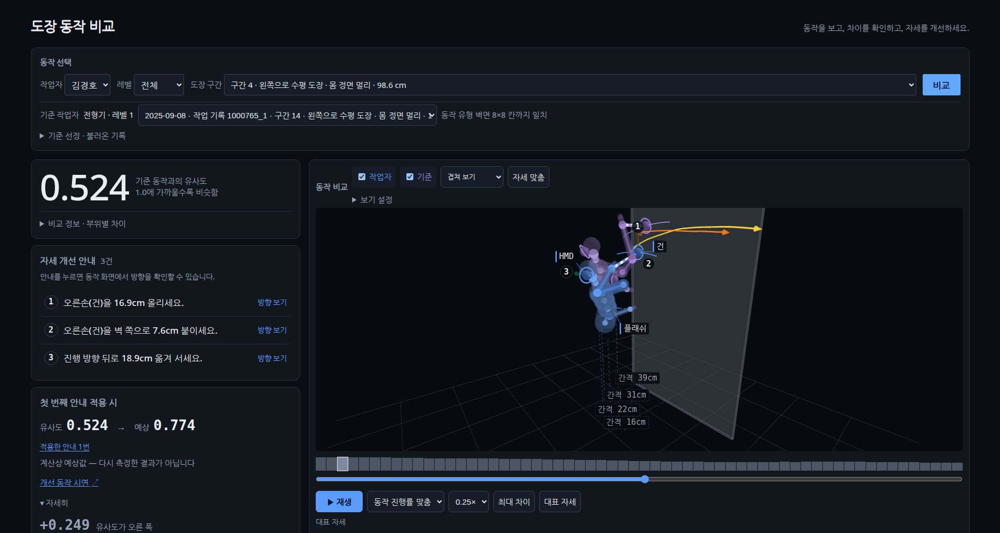
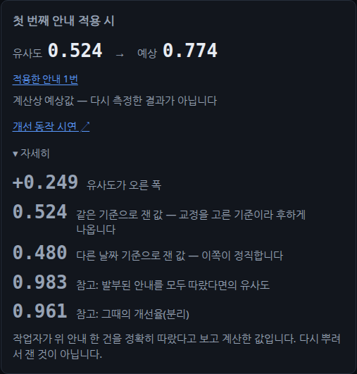
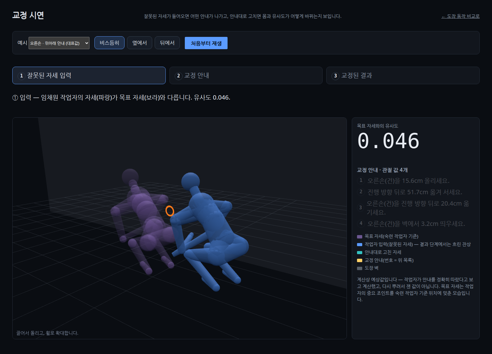
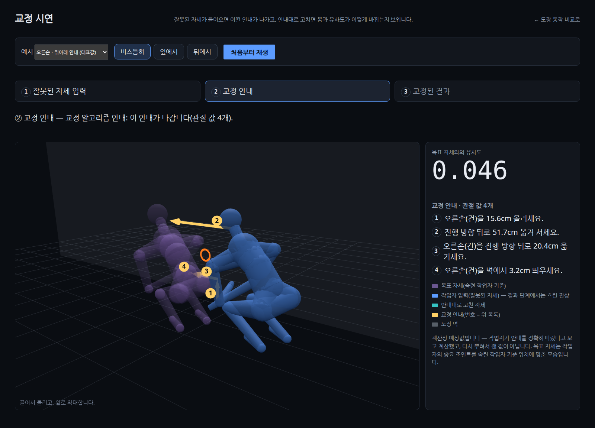
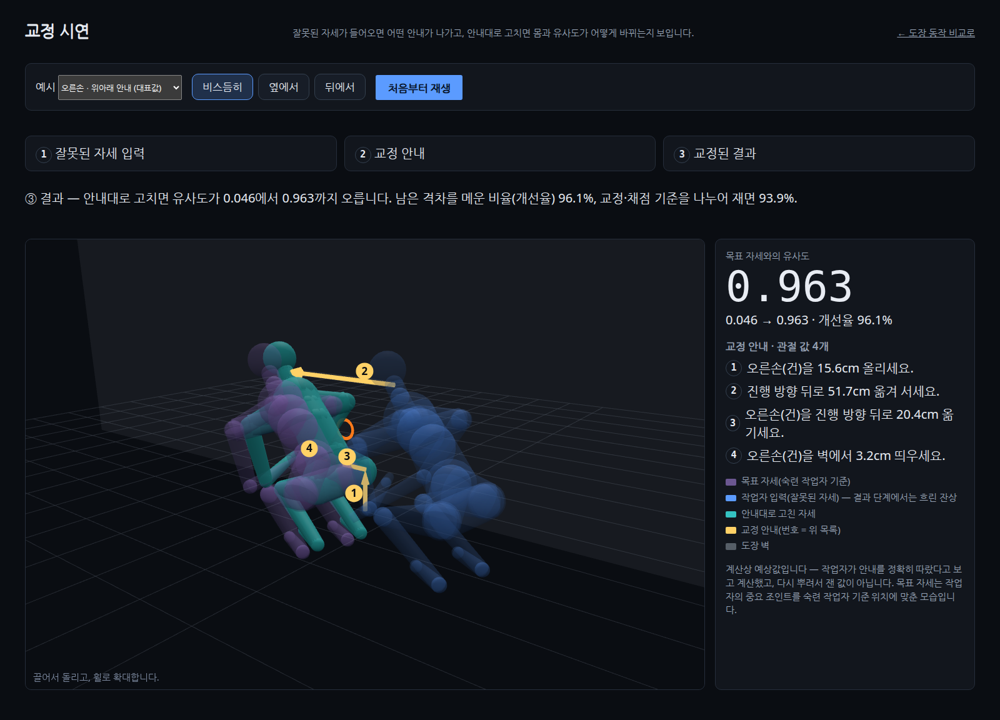

# 2차년도 KPI 시험 방법 — 작업 자세 교정 정확도 70%

작성 2026-10-01 · 대상 KPI: **작업 자세 교정 정확도 70%(2차년도)**
관련: 3차년도 시험 방법 `docs/year3/KPI_시험방법.md`

---

## 1. 시험 항목

| 항목 | 내용 |
|---|---|
| KPI | 작업 자세 교정 정확도 — 2차년도 **70%**, 3차년도 90% 이상 |
| 정의 | 구축된 도장 숙련 작업자 자세 데이터를 기준으로, 작업 자세 교정 모듈을 통해 변화된 자세와 기존 자세를 목표 자세와의 유사도로 비교하여 개선된 비율을 측정 |
| 측정 방법 | 작업자의 기존 자세와 목표 자세를 입력으로, **6개 이하의 주요 관절 값을 조정**하는 자세 교정 알고리즘을 적용한 뒤 유사도를 비교하여 개선율 산출. **10회 이상 적용하여 평균치** 측정 |
| 교정 전 자세 유사도 | S0 = 유사도(목표 자세, 교정 전 자세) |
| 교정 후 자세 유사도 | S_corrected = 유사도(목표 자세, 교정 후 자세) |
| 정확도 | **정확도(%) = (S_corrected − S0) / (1 − S0) × 100** 의 평균 |

정확도 식은 "교정 전에 목표와 벌어져 있던 격차 중 교정으로 메운 비율"이다. 코드의 `pose_similarity.gap_closure`가
같은 식이다.

## 2. 개발 과정

| 단계 | 내용 | 근거 |
|---|---|---|
| ① 데이터 구축 | 숙련 작업자 6명(김경호·손영석·임채원·전형기·정희록·최연진)의 XR 도장 시뮬레이터 기록 479 세션을 분사 구간(패스) 64,098개로 나눴다. 패스마다 작업자의 중요 조인트 위치를 분사 착탄점 기준 좌표(벽 쪽·진행 방향·위아래)로 바꿨다 | `trainer/pose_lab/csv_source.py`, `service._local_tracks` |
| ② 목표 자세 | 기준 작업자(전형기)의 같은 레벨·같은 동작 유형 패스를 목표 자세로 고른다(화면이 처음 보이는 기준). 동작 유형은 벽면 위치·진행 방향·거리로 만든 키(m3)다 | `service.reference_candidates`, `motion_key.py` |
| ③ 유사도 모델 | 중요 조인트의 축별 이탈을 **숙련자가 같은 동작을 반복할 때의 산포(σ)**로 정규화하고 조인트별 가중치로 합성한 유사도(0–1, 1.0이 같음) | `measured_score.score_track`, 산포 `/output/spread_reference_expert_m3.json` |
| ④ 교정 알고리즘 | 축 σ가 0.1을 넘고 1cm 이상인 이탈을 안내로 낸다. 오른손은 축마다(최대 3), 머리는 자세 문장 하나(최대 1) — **관절 값 최대 4개**. 안내 하나 = 한 점을 한 축으로 몇 cm 옮기라는 것 | `measured_score.issued_axes` |
| ⑤ 개선 | σ 게이트를 2.0→0.1로 낮춰 교정이 나가는 쌍을 절반이 안 되던 것에서 거의 전부로 늘렸고, 머리 자세 문장에 진행 방향 축을 더해(C1) 0.70 이상 쌍을 82.6%→91.6%로 올렸다. 무작위로 축을 고르는 대조군은 오히려 낮아(78.4%) 이득이 σ 순위에서 온다는 것을 확인했다 | `docs/measurements/2026-09-23-head-lateral-stance-axis-prereg.md`, 커밋 be78b30·cb9a527 |
| ⑥ 정직한 채점 | 교정을 고른 기준으로 다시 재면 후하게 나온다. 날짜를 반으로 나눠 A(교정 선택)·B(채점)를 분리한 split 채점을 함께 낸다 | `service.improvement`, `docs/literature_basis.md` §4 |
| ⑦ 작업자 화면 | 작업자에게 한 번에 전달되는 안내는 σ 1위 **1건**이다. 화면의 "예상 결과"는 그 1건만 따랐을 때로 계산한다(2026-10-01) | 커밋 993e30e |
| ⑧ 전수 측정 | 표본(200쌍)이 아니라 색인된 패스 **전부**로, 측정 전에 정의·예측을 등록하고 잰다 | `docs/measurements/2026-10-01-delivered-cue-improvement-prereg.md`(534f70d) |

## 3. 개발 결과

| 구성 | 위치 | 하는 일 |
|---|---|---|
| 교정 알고리즘 | `trainer/scripts/measured_score.py` | 이탈 → 안내(점·축·cm) → 교정 후 자세 |
| 비교·교정 화면(8130) | `trainer/pose_lab/` (`app.py`, `static/index.html`) | 작업자 패스를 고르면 유사도, 자세 개선 안내 문장, 안내를 따랐을 때의 예상 결과, 3D 비교를 보인다 |
| 교정 시연 화면(8130) | `trainer/pose_lab/static/demo.html`, `correction_demo.py` | ① 잘못된 자세 입력 → ② 교정 안내 → ③ 교정된 결과를 3D 사람 몸으로 한 흐름에 재생한다 |
| KPI 측정 도구 | `trainer/scripts/delivered_cue_study.py` | 64,098 패스 전수를 20개 프로세스로 재고 CSV로 집계한다 |
| 시연 녹화 도구 | `trainer/pose_lab/record_demo.mjs` | 이 문서의 그림과 영상을 다시 만든다 |

## 4. 시험 방법

### 4.1 시험 환경

| 항목 | 값 |
|---|---|
| 실행 환경 | Docker 컨테이너 `ship-paint-trainer`(Python 3.11.9), 저장소를 `/workspace`에 연결 |
| 시험 데이터 | `/data/sources/professionals` — 숙련 작업자 6명, 479 세션, 패스 64,098개 |
| 패스 색인 | `/output/samelevel/index_cache_m3.json`(CSV 트리 지문 일치 확인 후 사용) |
| 숙련자 산포 | `/output/spread_reference_expert_m3.json` |
| 화면 | pose_lab `http://<호스트>:8130` |

### 4.2 시험 절차

1. **쌍 만들기** — 패스 64,098개 각각을 작업자 자세(교정 전)로 두고, 화면과 같은 규칙으로 목표 자세(전형기의 같은 레벨·같은
   동작 유형 패스 중 첫 후보)를 붙인다. 목표 후보가 없는 1,981쌍은 `no_expert_reference`로 기록하고 분모에서 뺀다.
2. **교정 전 유사도 S0** — 목표 자세와 교정 전 자세의 유사도.
3. **교정 적용** — 교정 알고리즘(`issued_axes`, 관절 값 ≤ 4개)이 낸 안내를 그대로 따른 자세를 만든다.
4. **교정 후 유사도 S_corrected** — 목표 자세와 교정 후 자세의 유사도.
5. **정확도** — 쌍마다 (S_corrected − S0)/(1 − S0)를 내고 평균한다. S0 = 1(이미 같음)인 쌍은 정의되지 않아 뺀다.
   0으로 채우지 않는다.
6. 같은 계산을 두 채점 방식으로 낸다.
   - **same**: 교정 선택과 채점에 같은 숙련자 산포를 쓴다(평가 문구 그대로).
   - **split**: 숙련자 기록을 날짜로 반씩 나눠 A로 교정을 고르고 B로 채점한다(더 엄격).

실행 명령(컨테이너, 저장소 루트):

```bash
# 20개 프로세스로 전수 측정 (약 7분)
for i in $(seq 0 19); do
  python3 trainer/scripts/delivered_cue_study.py shard \
    --root /data/sources/professionals \
    --reference /output/spread_reference_expert_m3.json \
    --index-cache /output/samelevel/index_cache_m3.json \
    --out-dir /output/delivered_cue --shards 20 --shard $i &
done; wait

# 집계와 CSV
python3 trainer/scripts/delivered_cue_study.py aggregate \
  --reference /output/spread_reference_expert_m3.json \
  --out-dir /output/delivered_cue --report /output/delivered_cue_report.json \
  --csv-dir /output/delivered_cue/csv
```

### 4.3 판정 기준

- 적용 횟수 ≥ 10회.
- 조정한 관절 값 ≤ 6개.
- **정확도 평균 ≥ 70% → 2차년도 KPI 달성.** 판정은 엄격한 split으로 하고 same을 함께 싣는다.

## 5. 검증 결과

측정 2026-10-01 · 결과 문서 `docs/measurements/2026-10-01-delivered-cue-improvement-result.md` · CSV `/output/delivered_cue/csv/`

| 교정 | 조정한 값 | 적용 횟수 | split 정확도 | same 정확도 | 2차년도 70% |
|---|---|---|---|---|---|
| **교정 알고리즘(발부 안내 전부)** | **1–4개** | **61,477회** | **85.9%** | **87.7%** | **달성** |
| 참고: 작업자에게 한 번에 전달되는 안내 1건만 | 1개 | 61,477회 | 32.1% | 36.0% | — |

- 판정: **split 85.9% ≥ 70% → 2차년도 KPI 달성.** 조건 충족: 적용 61,477회(≥ 10), 조정 값 최대 4개(≤ 6).
- 개선율 중앙값 0.898(사분위 0.820–0.945). 교정 후 유사도가 오히려 내려간 쌍 0%.
- 작업자별 split 정확도: 김경호 84.9% · 손영석 85.8% · 임채원 86.9% · 전형기 84.7% · 정희록 86.2% · 최연진 86.1% — 6명 모두 70% 이상.
- 같은 계산을 3차년도 측정 경로(`service.compare(correction_policies=…)`)로 다시 돌려 62,117쌍 모두에서 같은 값이 나왔다
  (불일치 0, `docs/year3/2026-10-01-six-value-correction-result.md`).
- 자동 시험: 시연 화면 숫자가 측정과 같은 계산인지(`trainer/pose_lab/tests/test_correction_demo.py`), 집계가 None을 0으로
  채우지 않는지(`trainer/scripts/tests/test_delivered_cue_study.py`)를 포함해 전체 시험이 통과한다.

## 6. 시연 절차 (8130)

8130을 실데이터로 띄운다(컨테이너, 저장소 루트):

```bash
POSE_LAB_DATA_ROOT=/data/sources/professionals \
POSE_LAB_SPREAD_REFERENCE=/output/spread_reference_expert_m3.json \
ARM_REFERENCE_PATH=/output/expert_reference/expert_arm_reference.json \
PYTHONPATH=trainer/scripts:. python3 -m uvicorn trainer.pose_lab.app:create_app --factory --host 0.0.0.0 --port 8130
```

### 6.1 도장 동작 비교 화면 — 안내 문구가 나오고 예상 결과가 오르는 것을 확인

1. 작업자·레벨·도장 구간을 고르고 **비교**를 누른다. 기준 작업자(전형기)의 같은 유형 동작이 자동으로 잡힌다.
2. 왼쪽 위 **유사도**(교정 전, S0)와 그 아래 **자세 개선 안내** 문장을 확인한다. 안내의 **방향 보기**를 누르면 3D에서
   그 안내의 화살표가 강조된다.
3. **첫 번째 안내 적용 시**에서 "유사도 0.524 → 예상 0.774"처럼 작업자에게 전달되는 안내 1건을 따랐을 때의 상승을 확인한다.
   "자세히"를 펴면 발부된 안내를 모두 따랐을 때의 값(KPI 정의)도 보인다.
4. **개선 동작 시연**을 누르면 같은 쌍이 6.2의 시연 화면으로 열린다(알고리즘 안내 전부를 따른 결과를 보인다).
5. 몸 자세가 해부학적으로 맞지 않으면(머리가 몸통 정면에서 80° 넘게 돌아간 경우) 그 몸을 흐리게 그리고 3D 바로 아래에
   "추정 자세" 문장을 띄운다.




### 6.2 교정 시연 화면 — 잘못된 자세 → 교정 안내 → 교정된 결과

주소: `http://<호스트>:8130/demo.html` (도장 동작 비교 화면의 **개선 동작 시연**으로 열면 같은 쌍이 열린다)

화면에는 연차를 적지 않는다. 기본으로 보이는 교정은 **교정 알고리즘이 낸 안내 전부(관절 값 4개 이하)** — KPI 정확도의
정의와 같다.

- **사람으로 그린다.** 8130 3D 뷰와 같은 전신 골격과 살 두께를 쓴다. 작업자(파랑), 목표 자세(보라 반투명), 안내대로 고친
  자세(청록), 도장 벽(회색 면), 분사가 벽에 닿는 점(주황 고리)을 한 장면에 둔다. 끌어서 돌리고, **비스듬히·옆에서·뒤에서**
  단추로 보는 방향을 바꾼다.
- **목표 자세의 몸**은 작업자의 몸에서 중요 조인트를 숙련 작업자 기준 위치로 옮긴 모습이다 —
  채점이 보는 목표와 같은 자리다. 그래서 교정이 메우지 않은 만큼 교정된 몸과 목표 몸 사이가 남는다.
- **안내대로 고친 몸**은 다음 규칙으로 만든다(`trainer/pose_lab/correction_demo.py`).
  - 손 안내: 손이 안내한 위치로 가고, 팔꿈치가 위팔·아래팔 길이를 지켜 굽는다. 팔 길이로 닿지 않으면 쇄골 길이를 지킨 채
    어깨 관절을 손 쪽으로 돌리고(최대 35°), 그래도 모자라면 손이 못 미친 채로 두고 안내 옆에 "팔 길이로 n cm 못 미칩니다"를 적는다.
  - 안내가 없는 손은 몸을 따라 움직인다.
  - **어떤 뼈도 길이가 바뀌지 않는다**(자동 시험 `test_no_bone_ever_changes_length`, 모든 뼈·모든 단계).
  - "옮겨 서세요"(머리 수평): 몸 전체가 옮겨 간다.
  - "자세를 높여/낮춰 작업하세요"(머리 수직): 발은 디딘 채 골반 위가 오르내리고, 무릎이 다리 길이를 지켜 굽거나 펴진다.
    **발은 절대 바닥에서 뜨지 않는다** — 다리가 다 펴지는(또는 다 접히는) 데서 멈추고, 못 미친 높이를 안내 옆에
    "발을 디딘 채로는 n cm 못 미칩니다"로 적는다(자동 시험 `test_feet_stay_on_the_floor_in_every_demo_body`).
  - 화살표의 길이는 안내 문장의 cm와 같다(자동 시험 `test_each_arrow_is_the_spoken_amount`).
- 예시는 사람이 고르지 않고 규칙으로 뽑았다: 안내 종류(오른손·머리 × 3축)마다 안내 1건 개선율이 그 종류의 중앙값에 가장
  가까운 쌍(`trainer/pose_lab/demo_scenarios.py`). 그래서 예시의 개선율은 전수 평균과 같지 않다.
- 재생은 자동이다.
  1. **잘못된 자세 입력**: 작업자 몸과 목표 몸, 교정 전 유사도.
  2. **교정 안내**: 안내 문장이 하나씩 나타나고, 몸의 해당 부위에서 노란 화살표(번호 = 문장 번호)가 옮길 방향과 거리를 가리킨다.
  3. **교정된 결과**: 작업자 몸이 안내대로 움직이는 동안 유사도가 실제 채점값으로 오른다(교정 0→100%를 20단계로 채점하고
     몸도 그 비율로 만든다). 끝나면 고친 몸이 청록으로 바뀌고, 교정 전 몸이 흐린 잔상으로 남으며, "유사도 a에서 b까지,
     개선율 c%"가 나온다.

예시 "오른손 · 위아래 안내(대표값)" — 임채원 L10 1000088_1 #93 대 전형기 1000588_1 #33:

| 안내(관절 값 4개) | 유사도 | 개선율(same / split) |
|---|---|---|
| ① 오른손(건)을 15.6cm 올리세요. ② 진행 방향 뒤로 51.7cm 옮겨 서세요. ③ 오른손(건)을 진행 방향 뒤로 20.4cm 옮기세요. ④ 오른손(건)을 벽에서 3.2cm 띄우세요. | 0.046 → 0.963 | 96.1% / 93.9% |





## 7. 시연 영상

| 파일 | 내용 | 길이 |
|---|---|---|
| `/output/year2/demo/교정시연_issued.mp4` | 오른손 대표값(비스듬히) → 머리 · 위아래 대표값(옆에서, "자세를 41.3cm 높여" 몸이 펴지는 모습) | 약 36초 |

호스트 경로는 `/data/ship-paint-ai/output/year2/demo/`이다. 같은 이름의 `.webm`은 녹화 원본이다. 다시 만들기(8130이 떠 있을 때,
저장소 루트에서): `node trainer/pose_lab/record_demo.mjs issued docs/year2/img <영상 폴더>`

## 8. 해석할 때 함께 적을 것

- **계산상 예상값이다.** 작업자가 안내를 정확히 따랐다고 보고 계산했다. 안내를 들은 뒤 다시 뿌려서 잰 값이 아니다.
- **숙련자 대 숙련자다.** 코퍼스에 훈련생 기록이 없다. 숙련자끼리의 작은 차이를 교정한 결과다.
- **KPI는 알고리즘 기준, 화면은 작업자 기준이다.** KPI 정확도 85.9%는 알고리즘이 발부한 안내를 모두 따른 값이다.
  작업자에게 한 번에 전달되는 1건만 따르면 32.1%다.

## 9. 산출물

| 종류 | 위치 |
|---|---|
| 사전등록·결과 | `docs/measurements/2026-10-01-delivered-cue-improvement-prereg.md`, `…-result.md` |
| CSV | `/output/delivered_cue/csv/` — `정확도_평가방법.csv`, `요약.csv`, `전달_안내별.csv`, `작업자별.csv`, `교정전_유사도_구간별.csv`, `쌍별_원자료.csv`(64,098행) |
| 원자료 | `/output/delivered_cue/shard_*.jsonl` |
| 그림 | `docs/year2/img/` |
| 영상 | `/output/year2/demo/` |
