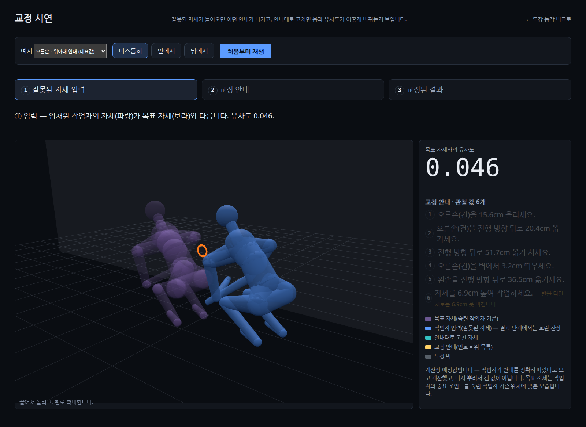
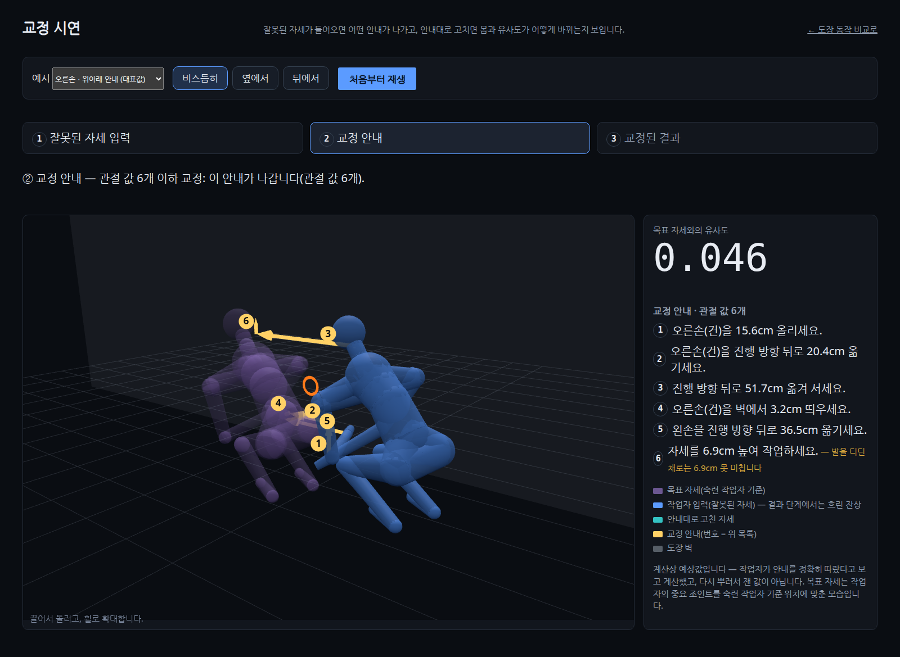
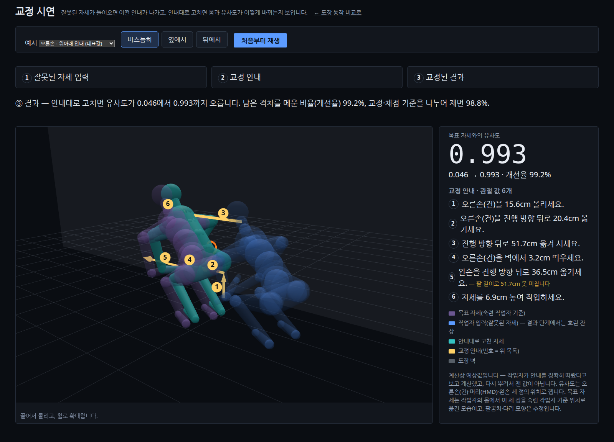

# 3차년도 KPI 시험 방법 — 작업 자세 교정 정확도 90% 이상

작성 2026-10-01 · 대상 KPI: **작업 자세 교정 정확도 90% 이상(3차년도)**
3차년도 제출 자료는 2차년도와 섞지 않는다 — 코드 `trainer/year3/`, 문서 `docs/year3/`, 산출물 `/output/year3/`.
2차년도 시험 방법: `docs/year2/KPI_시험방법.md`(시험 환경·데이터·유사도 모델은 같다)

---

## 1. 시험 항목

| 항목 | 내용 |
|---|---|
| KPI | 작업 자세 교정 정확도 — 2차년도 70%, **3차년도 90% 이상** |
| 측정 방법 | 작업자의 기존 자세와 목표 자세를 입력으로, **6개 이하의 주요 관절 값을 조정**하는 자세 교정 알고리즘을 적용한 뒤 유사도를 비교하여 개선율 산출. **10회 이상 적용하여 평균치** 측정 |
| 정확도 | **정확도(%) = (S_corrected − S0) / (1 − S0) × 100** 의 평균. S0 = 유사도(목표, 교정 전), S_corrected = 유사도(목표, 교정 후) |

## 2. 개발 과정

| 단계 | 내용 | 근거 |
|---|---|---|
| ① 출발점 | 2차년도 교정 알고리즘은 정확도 85.9%(split)로 70%는 넘지만 90%에 못 미쳤다 | `docs/year2/KPI_시험방법.md` §5 |
| ② 원인 | 2차년도 알고리즘은 관절 값을 **최대 4개**(오른손 3축 + 머리 1축)만 조정하고 왼손은 옮기지 않는다. 평가 방법은 6개까지 허용한다 — 남은 2개를 쓰지 않고 있었다 | `measured_score.issued_axes` |
| ③ 정의 | "관절 값 하나" = 중요 조인트 하나의 한 축(벽 쪽·위아래·진행 방향) 이동량. 후보는 제품과 같은 문턱(축 σ > 0.1, 1cm 이상)을 지킨다 | `trainer/year3/correction_policies.py` |
| ④ 정책 설계 | 6개를 무엇으로 채우나를 세 정책으로 비교한다: P0 2차년도 그대로(≤4) · P1 σ가 큰 순서로 6개 · **P2 목표 유사도를 가장 많이 올리는 값을 하나씩 6개까지(주 판정)** | 같은 파일 |
| ⑤ 측정 연결 | 2차년도 채점기를 그대로 쓰고 교정 목록만 바꿔 끼우도록 `service.compare`에 `correction_policies` 인자를 더했다. 주지 않으면 응답은 그대로다(2차년도 채점 격리 시험 통과) | 커밋 b30f3f8 |
| ⑥ 사전등록 | 정의·판정 기준·예측을 측정 전에 커밋했다 | `docs/year3/2026-10-01-six-value-correction-prereg.md` |
| ⑦ 전수 측정 | 64,098 패스 전부, 20개 프로세스 | `trainer/year3/six_value_study.py` |
| ⑧ 시연 | 8130 교정 시연 화면에 **숨김 방식**으로 올렸다 — 목록에 나오지 않고 주소로만 열린다(코드는 `trainer/year3/demo_mode.py`) | §6 |

## 3. 개발 결과

| 구성 | 위치 | 하는 일 |
|---|---|---|
| 3차년도 교정 정책 | `trainer/year3/correction_policies.py` | 후보 중 목표 유사도를 가장 많이 올리는 관절 값을 6개까지 고른다(P2) |
| 측정 연결 | `trainer/pose_lab/service.py`(`compare(correction_policies=…)`), `trainer/scripts/measured_score.py`(`apply_corrections`) | 같은 쌍·같은 산포로 정책별 교정 후 유사도와 정확도를 낸다 |
| KPI 측정 도구 | `trainer/year3/six_value_study.py` | 전수 측정·집계·CSV |
| 시연(숨김) | `trainer/year3/demo_mode.py` → 8130 `demo.html?mode=six_values` | 잘못된 자세 → 관절 값 6개 이하 교정 안내 → 교정된 결과(3D 사람 몸) |
| 시험 | `trainer/year3/tests/test_correction_policies.py` | 6개 제한, 탐욕 선택, 2차년도 재현, split 분리 등 12건 |

## 4. 시험 방법

### 4.1 시험 환경·데이터

2차년도와 같다: 컨테이너 `ship-paint-trainer`(Python 3.11.9), 데이터 `/data/sources/professionals`(숙련 작업자 6명,
479 세션, 패스 64,098개), 색인 `/output/samelevel/index_cache_m3.json`, 숙련자 산포 `/output/spread_reference_expert_m3.json`.

### 4.2 시험 절차

1. 패스 64,098개 각각에 화면과 같은 규칙으로 목표 자세(전형기의 같은 레벨·같은 동작 유형 첫 후보)를 붙인다.
2. 쌍마다 교정 전 유사도 S0를 잰다.
3. 세 정책(P0–P2)으로 교정할 관절 값을 고르고, 그 값들을 그대로 옮긴 자세의 유사도 S_corrected를 잰다.
4. 쌍마다 (S_corrected − S0)/(1 − S0)를 내고 평균한다(same·split 두 방식, 2차년도 §4.2와 같다).
5. **재현 확인**: P0의 값이 2차년도 측정 값과 모든 쌍에서 같아야 한다. 다르면 결과를 쓰지 않는다.

실행 명령(컨테이너, 저장소 루트):

```bash
for i in $(seq 0 19); do
  python3 -m trainer.year3.six_value_study shard \
    --root /data/sources/professionals \
    --reference /output/spread_reference_expert_m3.json \
    --index-cache /output/samelevel/index_cache_m3.json \
    --out-dir /output/year3/six_values --shards 20 --shard $i &
done; wait

python3 -m trainer.year3.six_value_study aggregate \
  --out-dir /output/year3/six_values --report /output/year3/six_values/report.json \
  --csv-dir /output/year3/six_values/csv
```

### 4.3 판정 기준 (사전등록)

- 적용 횟수 ≥ 10회, 조정한 관절 값 ≤ 6개.
- **P2의 split 정확도 평균 ≥ 90% → 3차년도 KPI 달성.** same도 함께 싣는다.

## 5. 검증 결과

측정 2026-10-01 · 결과 문서 `docs/year3/2026-10-01-six-value-correction-result.md` · CSV `/output/year3/six_values/csv/`

| 교정 정책 | 조정한 값 | split 정확도 | same 정확도 | 3차년도 90% |
|---|---|---|---|---|
| P0 2차년도 알고리즘 | ≤ 4 | 85.9% | 87.7% | 미달 |
| P1 σ가 큰 순서로 6개 | ≤ 6 | 92.4% | 94.0% | 달성 |
| **P2 유사도 탐욕 선택 6개(주 판정)** | **≤ 6** | **97.6%** | **97.9%** | **달성** |

- 판정: **P2 split 97.6% ≥ 90% → 3차년도 KPI 달성.** 적용 61,502회(≥ 10), 조정 값 최대 6개.
- 재현 확인 통과: P0이 2차년도 값과 62,117쌍 모두에서 같다(불일치 0).
- P2 개선율 중앙값 0.989(사분위 0.976–0.995). 0.90 미만인 쌍 3.5%. 교정 후 유사도가 내려간 쌍 0%.
- 작업자별 P2 split 정확도: 김경호 97.8% · 손영석 97.8% · 임채원 98.1% · 전형기 96.2% · 정희록 97.9% · 최연진 97.8% — 6명 모두 90% 이상.
- 사전등록 예측(P2 split 95%, 범위 92–98%)과 맞았다.

## 6. 시연 절차 (8130) — 숨김 방식

3차년도 교정은 **숨겨 둔 기능**이다. 시연 화면의 목록·단추에 나오지 않고, 화면 어디에도 연차를 적지 않는다. 주소로만 연다.

```
http://<호스트>:8130/demo.html?mode=six_values
```

8130을 실데이터로 띄우는 명령은 2차년도 문서 §6과 같다. `trainer/year3`가 있을 때만 이 방식이 등록된다
(`trainer/year3/demo_mode.py`). 화면 구성·몸을 고치는 규칙·재생 순서는 2차년도 문서 §6.2와 같고, 안내가 관절 값 6개
이하로 늘어난 것만 다르다.

1. **잘못된 자세 입력**: 작업자 몸(파랑)과 목표 몸(보라 반투명), 교정 전 유사도.
2. **교정 안내**: 관절 값 최대 6개의 안내 문장이 하나씩 나타나고, 몸의 해당 부위에서 번호 달린 노란 화살표가 나온다.
   2차년도 알고리즘이 쓰지 않던 왼손과 머리의 다른 축 안내가 여기 더해진다.
3. **교정된 결과**: 몸이 안내대로 움직이며 유사도가 실제 채점값으로 오르고, 고친 몸(청록)이 목표 몸에 더 가깝게 겹친다.

같은 예시를 기본 주소(`demo.html`, 관절 값 4개 이하)와 번갈아 재생하면, 남은 두 값을 더 옮긴 만큼 결과가 목표에 더 가까워지는
것이 보인다.

예시 "오른손 · 위아래 안내(대표값)" — 임채원 L10 1000088_1 #93 대 전형기 1000588_1 #33(예시 선정 규칙은 2차년도 문서 §6.2).

| 교정 | 조정한 값 | 유사도 | 개선율(same / split) |
|---|---|---|---|
| 기본(관절 값 4개 이하) | 오른손 위아래·진행·벽 쪽, 머리 진행 | 0.046 → 0.963 | 96.1% / 93.9% |
| **숨김 방식(관절 값 6개 이하)** | **위 4개 + 왼손 진행, 머리 위아래** | **0.046 → 0.993** | **99.2% / 98.8%** |

숨김 방식의 안내: ① 오른손(건)을 15.6cm 올리세요. ② 오른손(건)을 진행 방향 뒤로 20.4cm 옮기세요. ③ 진행 방향 뒤로 51.7cm
옮겨 서세요. ④ 오른손(건)을 벽에서 3.2cm 띄우세요. ⑤ 왼손을 진행 방향 뒤로 36.5cm 옮기세요. ⑥ 자세를 6.9cm 높여 작업하세요.





## 7. 시연 영상

| 파일 | 내용 | 길이 |
|---|---|---|
| `/output/year3/demo/교정시연_six_values.mp4` | 숨김 방식(관절 값 6개 이하): 오른손 대표값(비스듬히) → 머리 · 위아래 대표값(옆에서) | 약 41초 |

호스트 경로는 `/data/ship-paint-ai/output/year3/demo/`이다. 다시 만들기(8130이 떠 있을 때, 저장소 루트에서):
`node trainer/pose_lab/record_demo.mjs six_values docs/year3/img <영상 폴더>`

## 8. 해석할 때 함께 적을 것

- **정확도는 허용한 관절 값 수의 영향을 받는다.** 97.6%는 평가 방법의 조건(관절 값 6개 이하)에서의 값이다.
- **계산상 예상값이다.** 작업자가 6개 안내를 모두 정확히 따랐다고 보고 계산했다. 왼손·머리 이동을 따를 수 있는지, 따른 뒤
  다시 쟀을 때 같은지는 재지 않았다.
- **숙련자 대 숙련자다.** 훈련생 기록이 없다.
- **작업자 화면은 바꾸지 않았다.** 작업자에게 한 번에 전달되는 안내는 여전히 1건이다. P2는 평가 방법이 정한 교정 알고리즘이다.

## 9. 산출물

| 종류 | 위치 |
|---|---|
| 사전등록·결과 | `docs/year3/2026-10-01-six-value-correction-prereg.md`, `…-result.md` |
| CSV | `/output/year3/six_values/csv/` — `정확도_평가방법.csv`, `조정값수_분포.csv`, `조정부위_사용.csv`, `작업자별.csv`, `교정전_유사도_구간별.csv`, `쌍별_원자료.csv`(64,098행) |
| 원자료 | `/output/year3/six_values/shard_*.jsonl`, `report.json` |
| 그림 | `docs/year3/img/` |
| 영상 | `/output/year3/demo/` |
