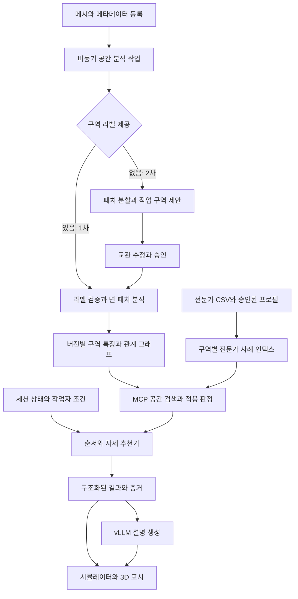

# 구역 형상 기반 선박도장 훈련 코파일럿 PRD

작성일: **2026-10-16**. 상태: **개발 범위·검증 기준 제안**. 공간 분석 근거: [구역 공간 분석과 기술 조사](zone_spatial_analysis_2026-10-16.md). 이 문서는 제품 요구사항이며 기능 구현이나 성능 검증 완료를 뜻하지 않는다.

## 1. 제품 목표와 확정된 전제

새로운 선박도장 대상 메시의 구역을 기존 전문가 훈련 구역과 비교해 **유사한 형상, 적용 가능한 작업 순서, 표면과 작업자 조건에 맞는 자세**를 근거와 함께 추천한다. 기존 JSON·CSV 분석과 vLLM·MCP 구성에 공간 레퍼런스 검색을 추가한다.

| 구분 | 확정 내용 |
|---|---|
| 최종 입력 | zoneID가 없는 3D 메시. GLB·FBX·OBJ 등 |
| 초기 테스트 입력 | zoneID가 이미 부여된 메시. 분할 오차를 제외하고 매칭·추천부터 검증 |
| 초기 테스트 자산 상태 | **현재 미확보**. 확보 예정일·형상 수·라벨 저장 방식은 정해지지 않음 |
| 현재 레퍼런스 | 학습 FBX 10개, 학습 87개 구역, 자격·유닛을 포함한 라벨 항목 190개, 학습 CSV 479개 |
| 추론 환경 | 외부 vLLM OpenAI 호환 서버와 FastAPI MCP. 기존 HF NF4 학습·평가 경로 유지 |
| 사용자 | 훈련생, 훈련 교관, 모델·레퍼런스를 등록하는 운영자 |
| 이번 산출물 | 공간 분석 보고서와 본 PRD. 구현·배포는 별도 작업 |

**1차 출시 범위는 라벨이 있는 메시의 형상 매칭과 근거 있는 추천이다.** 라벨 없는 메시를 자동으로 작업 구역으로 나누는 기능은 같은 분석 엔진 앞에 연결하는 2차 범위다. 최종 목표를 유지하면서 분할 실패와 추천 실패를 각각 측정하기 위한 순서다.

## 2. 해결할 문제와 성공 경험

현재는 알려진 레벨·구역에 연결된 CSV·JSON을 분석한다. 새 모델의 zone 번호가 `"3"`이라고 해서 기존 학습03의 `"3"`과 같은 형태나 작업이라는 의미는 없다. 특히 하나의 zone이 여러 면을 포함하거나 하나의 평판이 여러 작업 구역으로 나뉘는 경우, 외형 유사도만으로 순서·자세를 복사하면 잘못된 안내가 된다.

훈련생이 새 모델의 특정 구역을 선택하면 시스템은 다음을 제공한다.

1. 대상 구역의 위치와 형태: 예를 들어 “상단의 가로 보강판 아래쪽 면”.
2. 적용 가능한 레퍼런스 후보 최대 3개와 근거: 평면/곡면, 실제 크기, 국소 면 구성, 중력 방향, 주변 차폐의 공통점과 차이.
3. 현재 완료 상태와 접근 조건을 고려한 다음 작업 구역 및 대안.
4. 적용 가능한 전문가 사례, 건 방향·거리·이동 방향·자세 안내. 조건이 부족하면 가능한 안내 수준과 보류 사유.

수치나 자세를 제시할 근거가 없으면 “유사 형상 후보는 있으나 설치 높이가 없어 자세 추천은 보류”처럼 부분 결과를 반환한다. 설명문은 분석 결과와 일치해야 하며 레퍼런스가 없는 값을 생성하지 않는다.

## 3. 범위와 단계

| 단계 | 제공 기능 | 진입 조건 | 완료 기준 |
|---|---|---|---|
| R0 레퍼런스 정리 | 구역 사전, 기하 특징, 전문가 사례 연결, 버전·품질 관리 | 현재 자료로 시작 가능 | 190개 키 전수 목록, 87개 학습 구역의 승인/보류 구분, 근거 추적 가능 |
| R1 라벨 메시 분석 | 구역 위치·형태 분석, Top-k 검색, 미일치 판정 | 구역 라벨과 메시 계약 확정 | 내부 회귀 통과 + 외부 테스트 메시에서 검색 목표 충족 |
| R2 순서·자세 추천 | 구역 관계 기반 계획, 국소 좌표의 전문가 사례 전이 | 검색 품질, 설치 정보, 전문가 정답 확보 | 교관 평가와 계약·지연 목표 충족 |
| R3 자동 작업 구역 제안 | 라벨 없는 메시의 패치 분할·구역 묶기·교관 수정 | 라벨 있는 독립 평가셋 확보 | 분할과 이후 추천의 성능을 별도로 충족 |

R1과 R2의 개발은 일부 병행할 수 있으나, 외부 평가 자산이 없으면 독립 모델 검증 완료로 승인하지 않는다. R3에서는 기존 라벨을 숨긴 동일 평가 메시를 사용해 R1·R2와 비교한다.

초기 범위에서 실물 로봇 제어, 도장 물리의 신규 고정밀 시뮬레이터, 이미지에서 새 3D 형상을 생성하는 기능, CAD B-rep·스캔 복원 전반, 모든 형상에 대한 완전자동 정답 보장은 다루지 않는다. 작업 대상은 훈련 코칭이며 관측된 인간 시연을 무조건 재생하는 기능이 아니다.

## 4. 사용자 흐름

### 4.1 운영자의 메시 등록

운영자는 메시와 메타데이터를 등록한다. 시스템은 단위·축·노드 변환·라벨을 검증하고 비동기 분석 작업을 생성한다. 분석이 끝나면 구역 목록, 3D 위치·법선·연결, 구역별 품질 문제를 보여준다. 교관이 잘못된 라벨과 의미를 수정한 뒤 승인된 레퍼런스 버전을 발행한다. 새 대상 메시를 등록하는 것과 전문가 레퍼런스로 발행하는 것은 별도 상태다.

### 4.2 라벨 있는 테스트 메시의 추천

테스트 담당자는 외부 메시와 구역 매핑을 입력한다. 시스템은 제공된 경계를 유지하고 각 구역 내부를 분석용 면 패치로 나눈다. 대상 zoneID는 식별자로만 사용하며 후보 점수에 넣지 않는다. 유사 구역을 검색한 뒤 교관이 준비한 정답과 비교한다. 추천 계획·자세 평가에는 현재 구역, 완료 구역, 설치·작업자 조건을 추가한다.

### 4.3 라벨 없는 모델의 최종 흐름

시스템은 먼저 기하 패치를 분할한 다음 작업 조건에 따라 패치들을 구역으로 묶어 제안한다. 교관은 분할·병합·비도장면 제외를 수정할 수 있다. 승인 전 구역은 임시 proposal ID로 관리한다. 발행할 때 숫자 문자열 zoneID를 부여하고, 이후 변경은 새 자산 리비전으로 남긴다. 단순히 “매번 N개 부품으로 나누기”를 도장 구역 생성으로 정의하지 않는다.

## 5. 입력 데이터 계약

다음은 **새 분석 서비스의 제안 계약**이다. 기존 v2.5 API에 아래 필드나 경로가 이미 있다고 가정하지 않는다.

### 5.1 메시와 공간 정보

| 필드 | 필요 시점 | 규칙 |
|---|---|---|
| asset_id, asset_revision, mesh_sha256 | 항상 | 자산과 버전을 불변으로 식별. 같은 바이트와 설정은 분석 캐시 재사용 |
| geometry_format | 항상 | 1차 GLB, OBJ. 기존 학습 FBX는 검증된 변환 경로. 범용 FBX는 다중 노드·UV·축 사례 통과 후 지원 |
| mesh 또는 허용된 asset_uri | 항상 | 원본 보존. 외부 URL·파일 경로를 무제한 역참조하지 않음 |
| units, up_axis, handedness | 항상 | 단위를 추측해 확정하지 않음. 미제공이면 형상 후보 탐색만 제한적으로 수행 |
| node_transforms, mesh_to_world | 월드 분석·자세 | 원본 노드 계층, 변환 순서, 행렬 규약 명시. 비균일 scale·반사는 검증 항목 |
| paintable_surface | 구역 생성·커버리지 | 마스크·face 목록·운영자 선택 중 하나. 없으면 도장 대상 전체를 승인받기 전까지 제안 상태 |
| gravity, floor, obstacles | 설치 기반 순서·자세 | 중력·바닥·장애물 메타데이터. 모델의 최소 Y를 바닥이라고 가정하지 않음 |
| scenario_id ↔ asset_revision | API 연결 | 등록된 매핑 사용. 모델 파일명을 레벨 ID로 만들지 않음 |

기존 [FBX 리더](../trainer/scripts/level_mesh.py)는 단일 Geometry·Model과 특정 UV 매핑을 전제로 한다. 이를 그대로 범용 GLB·FBX·OBJ importer로 홍보하지 않는다. 변환기는 원본 primitive·face와 정규화된 삼각형 사이의 대응표를 내보내야 한다. 변환·삼각분할·정점 병합 때문에 라벨이 옮겨 붙지 않도록 검증한다.

### 5.2 초기 테스트용 zone 라벨

우선 계약은 **primitive/face별 라벨 sidecar**다. GLB의 extras, OBJ group/material, FBX custom property 등은 합의한 adapter가 sidecar로 바꾼다. 단순 vertex color는 이산 팔레트와 경계 규칙을 함께 제공해야 한다.

```json
{
  "schema_version": "spatial-zone-input/1",
  "asset_id": "heldout-mesh-001",
  "asset_revision": "r1",
  "label_source": "provided",
  "label_encoding": "face_sidecar",
  "zones": [
    {
      "map_num": 1,
      "zone_id": "1",
      "primitive_id": "surface-0",
      "face_indices": [0, 1]
    }
  ]
}
```

위 JSON은 형식 예시이며 실제 확보된 테스트 메시가 아니다. 전체 등록에는 메시 해시와 §5.1 메타데이터가 추가로 필요하다. 여러 primitive에 걸친 zone은 동일 키의 face 집합으로 병합한다. 하나의 삼각형을 라벨 경계가 가로지르면 정밀 분할 또는 라벨 텍스처의 표면 적분을 사용하고, 삼각형 중심만 보고 전체 면을 잘못 배정하지 않는다.

추가 규칙은 다음과 같다.

- 실제 식별자는 `asset_revision + scenario_id + model_key + map_num + zone_id`. 저장소 인덱스는 자산과 모델의 소유 관계를 통해 같은 의미를 보장한다.
- `zone_id`는 기존 숫자 문자열을 그대로 유지한다. `"-1"`은 미판정, 라벨 이미지의 배경 0은 비구역이다.
- map_num이 다른 같은 zone 번호를 합치지 않는다. 복수 면인데 map_num이 누락되면 오류로 반환한다.
- UV 라벨 입력은 팔레트·UV set·map_num·원점·해상도·메시 리비전을 함께 제공한다. nearest 조회를 사용한다.
- 제공된 라벨을 임의 재번호화하거나 자동 분할 결과로 덮어쓰지 않는다. 분석용 patch ID와 외부 zoneID는 별개다.
- 누락·중복·경계 충돌 face를 집계하고 임의 채움은 금지한다. 검증 실패한 구역만 분리해 나머지 분석 가능 여부를 판단한다.

### 5.3 전문가 사례

필수 연결 키는 레퍼런스 자산 리비전·구역 키·시퀀스 ID·작업자 가명 ID·세션 ID다. 원본 프레임과 전처리 버전, 구역 내 착탄 비중, 자세 데이터 품질, 거리·속도·각도 분포, 도막 결과, 주사용 손, 체격 정보의 확보 여부를 보존한다. 결과가 없는 사례는 `quality_unknown`으로 두며 좋은 자세·좋은 도장 사례라고 확정하지 않는다.

## 6. 기능 요구사항

| ID | 우선순위 | 요구사항 | 검증 가능한 결과 |
|---|---|---|---|
| FR-01 | P0 | 메시 정규화와 계보 보존 | 원본 face→분석 face 대응, 단위·변환·해시 기록 |
| FR-02 | P0 | 제공 라벨 검증 | face 범위, 중복 키·중복 할당, 비도장면, map_num 검사 |
| FR-03 | P0 | 구역 공간 분석 | 면적·중심·AABB/OBB·곡률·법선 분포·연결 성분·개구부, 각각 상태·단위 포함 |
| FR-04 | P0 | 면 패치와 구역 관계 그래프 | 공유 경계·이면각·오목/볼록·상하·차폐를 구별. UV 인접을 3D 인접으로 대체하지 않음 |
| FR-05 | P0 | 형상·작업 조건 검색 | 최대 3개 후보, 부분/복합 대응, 특징별 점수와 근거 |
| FR-06 | P0 | 미일치·불확실성 판단 | raw 유사도와 보정된 confidence 분리, OOD·동률·모호한 대칭 처리 |
| FR-07 | P0 | 순서 추천 | 대상 모델의 zone 키만 반환. 선행 조건·완료 상태·접근 조건 반영, 대안 제공 |
| FR-08 | P0 | 자세·건 운용 추천 | 전문가 사례 ID, 국소 좌표의 건 방향·거리·진행 방향, 적용 조건·보류 사유 |
| FR-09 | P0 | 설명과 증거 | LLM 문장의 수치·참조 키가 분석 결과와 일치. 근거 없는 수치는 출력하지 않음 |
| FR-10 | P0 | 실패·부분 성공 계약 | 잘못된 입력과 분석 불가를 구분. 실패 컴포넌트와 reason_code, null 수치 |
| FR-11 | P1 | 시뮬레이터 피드백 반영 | 새 완료 상태·위치로 다음 구역 재평가, 재분석 없이 모델 특징 재사용 |
| FR-12 | P1 | 교관의 수정·승인 | 라벨·형태·허용 순서·적용 가능성 수정 이력과 버전 발행 |
| FR-13 | P2 | 라벨 없는 메시의 구역 제안 | 기하 패치와 작업 구역 계층, 분할·병합 편집, 승인 전 proposal 상태 |

### 6.1 구역 특징과 검색

기본안은 기하 특징과 주변 관계를 먼저 사용한다. 면적 가중 표면 샘플에서 형상 비율·법선 분포·곡률·경계·연결 성분을 계산한다. 평판, 원통형 곡면, 보강판, 오목 포켓, 개구부, 복합 구역을 구별할 수 있는 특징을 사용한다. 특정 레벨이나 색을 분류하는 모델로 문제를 축소하지 않는다.

검색 점수는 다음 네 묶음으로 설명한다. 가중치·문턱은 검증셋에서 정하고 시험셋 결과를 보고 다시 맞추지 않는다.

```text
geometry_similarity       형상·패치 구성의 유사성
neighborhood_compatibility 주변 경계·차폐·관계의 일치
task_compatibility         중력·치수·설치 높이·접근·작업 조건의 적합성
reference_quality          시연 품질·관측 수·자산 정합 상태
```

후보 검색과 적용 판정을 분리한다. 형상이 같아도 설치 조건이 달라 자세 전이가 안 될 수 있다. 구역 전체의 대응이 없으면 부분 대응 범위를 반환한다. 불일치한 나머지 영역에 같은 추천을 확장하지 않는다. 반복 평면의 ICP 잔차가 작다는 사실만으로 구역의 의미가 일치한다고 판정하지 않는다.

1차 인덱스는 작은 레퍼런스 규모에 맞는 명시적 특징 배열·메타데이터 저장으로 시작할 수 있다. 학습된 벡터를 도입하거나 사례가 커지면 별도 공간 collection을 사용한다. 문서 QA 텍스트 임베딩과 공간 임베딩을 같은 벡터 공간에 섞지 않는다. 기존 Qdrant 사용 여부는 구현 시 실제 운영 구성을 확인한다.

### 6.2 순서 추천

기존 `expert_zone_orders.json`의 최빈 순서와 전이 횟수를 **해당 레퍼런스의 경험적 사전정보**로 사용한다. 원본 생성기는 첫 방문 순서를 사용하므로 실제 재방문·보수 작업의 정책과 구분한다. 낮은 지지 수를 높은 confidence로 변환하지 않는다.

새 모델에서는 매칭된 형상·패치 역할을 대상 구역 그래프에 대응시킨다. 완료 구역 제외, 승인된 작업 선행 조건, 현재 위치, 접근 경로, 미도장 잔여 영역을 적용해 실행 가능한 후보를 선택한다. 기하 인접 그래프와 사람이 이동할 수 있는 경로 그래프는 별개다. 벽을 가로지르는 최단거리나 UV상 이웃을 이동 경로로 쓰지 않는다.

전체 계획은 하드 제약을 만족하는 순서와 허용 대안을 제공한다. 제약을 만족하는 해가 없으면 실패한 조건을 반환한다. 특정 순서가 관측되었다는 이유만으로 ‘항상 위에서 아래’, ‘항상 좁은 곳부터’ 같은 일반 작업 규칙을 새로 만들지 않는다. 재방문이 필요한 보수도장은 초기 완주 계획과 구분해 요청한다.

### 6.3 자세 추천과 동작 전이

자세 추천은 **건-표면 관계와 사람의 도달성**을 나눠 처리한다.

1. 승인된 레퍼런스 시퀀스에서 접점, 건 전방축, 표면 법선, 진행 접선, 거리·속도를 추출한다.
2. 표면 국소 좌표에서 동작을 표현하고 대상의 대응 패치로 이동시킨다. 필요한 분사 거리를 모델 크기에 비례해 무조건 확대하지 않는다.
3. 대상의 곡률·경계·개구부·차폐를 검사하고 패치별로 방향을 갱신한다. 구역 평균 법선 하나를 모든 접점에 적용하지 않는다.
4. 설치 높이·바닥·체격·주사용 손·관절 범위가 있을 때 인체 자세를 조정하고 충돌·도달성을 검사한다.
5. 체격이나 rig가 없으면 검증 가능한 건 운용과 자세 범주 안내까지만 제공한다. 전신 관절각·정확한 발 위치를 만들지 않는다.

국소 좌표 기반 전이는 [task-parameterized movement learning](https://www.idiap.ch/~scalinon/papers/Calinon-JIST2015.pdf)을 참고한다. 그 연구를 인간 도장 자세의 검증 결과로 간주하지 않는다. 기존 pose scorer는 **관측 시퀀스의 평가기**이므로 새 자세 생성기의 성공 여부를 독립적으로 평가해야 한다.

## 7. 현재 시스템과의 통합



모델 등록·분할·고비용 특징 추출은 비동기 처리한다. `/api/chat`이나 매 프레임 telemetry 요청에서 메시를 다시 읽거나 모델을 다시 임베딩하지 않는다. vLLM에는 원시 정점·삼각형 전체 대신 대상 구역 요약, 후보, 추천과 근거만 전달한다.

| 기존 위치 | 재사용할 역할 | 변경 시 지켜야 할 경계 |
|---|---|---|
| [zone_reference.py](../trainer/zone_reference.py) | 팔레트·구역·scenario 매핑 | 모델·면·zone 키 보존 |
| [level_mesh.py](../trainer/scripts/level_mesh.py), [정렬 JSON](../trainer/data/level_alignment.json) | 현재 10개 자산의 UV·기하와 정렬 provenance | 범용 importer와 구분. unverifiable 상태를 덮어쓰지 않음 |
| [map_expert_zones.py](../trainer/scripts/map_expert_zones.py) | 시퀀스 구역화, 80% 착탄 비중 필터, 기존 순서 | 작업자·세션 단위 분리, 원본 CSV 불변 |
| [build_zone_guidance_profiles.py](../trainer/scripts/build_zone_guidance_profiles.py) | 거리·속도 등 전문가 분포와 순서 | 근거 없는 고정 권장값 추가 금지 |
| [expert_guidance.py](../trainer/demo_api/expert_guidance.py) | 기존 실시간 가이드 | 새 다중 면 조회는 map_num까지 식별. zone_id 단독 조회에 의존하지 않음 |
| [pose_query.py](../trainer/demo_api/pose_query.py), [copilot_router.py](../trainer/demo_api/copilot_router.py) | 저장 시퀀스 평가와 구역 리포트 조회 | `pose_recomm`을 새 모델의 자세 생성으로 조용히 바꾸지 않음 |
| [sim_session.py](../trainer/demo_api/sim_session.py) | 기존 세션 상태 소유 | 별도 추천기가 복제한 세션을 authoritative state로 만들지 않음 |
| [MCP main](../mcp_servers/main.py), [공통 응답](../mcp_servers/common.py) | 도구 라우팅과 envelope | 새 라우터 추가 시 health의 router 수·schema·프로토콜도 함께 변경 |
| [agent_pipeline.py](../trainer/scripts/agent_pipeline.py), [openai_backend.py](../trainer/scripts/openai_backend.py) | 근거를 이용한 자연어 응답 | `run()` 평가 호환성 유지, streaming/boundary에서 연동 |

공간 라이브러리와 선택적 3D 모델은 별도 worker 이미지에 둔다. HF 훈련 컨테이너에 vLLM·3D CUDA 확장을 필수 의존성으로 추가하지 않는다. 현재 27B 추론과 GPU 메모리·큐가 경합하지 않도록 오프라인 처리·동시성 한도를 둔다. Spark aarch64 이미지의 실제 빌드·추론은 Spark에서 검증한다.

### 7.1 제안 도구와 공개 API 경계

| 제안 내부 도구 | 입력 | 출력 |
|---|---|---|
| `spatial.describe_zone` | 자산 리비전, map_num, zone_id | 위치·형태·품질·관계 |
| `spatial.match_reference` | 대상 구역 키, 작업 조건, top_k | 후보·부분 대응·점수·적용 가능성 |
| `spatial.recommend_sequence` | 대상 자산, 현재/완료 구역, 위치·제약 | 다음 구역·계획·대안·근거 |
| `spatial.recommend_pose` | 대상 구역, 채택 후보, 작업자·설치 조건 | 건 운용·자세 수준·시연 참조·보류 사유 |

도구명은 제안이며 현재 구현된 경로가 아니다. 기존 tool schema·protocol에 등록하고 구조화된 결과를 검증한 후 agent가 사용한다. 새 mesh 등록용 API와 분석 결과 조회는 우선 내부 전용으로 분리한다. 업로드는 작업 ID를 반환하고 상태 조회·취소·진행률을 제공한다. 공개 v2.5 확대가 필요하면 별도 버전 계약을 확정한다.

현재 공개 `knowledge_search`는 지식 검색, `pose_recomm`은 저장 시퀀스/구역 결과 조회이며 `trajectory_recomm`에는 미구현 경로가 있다. 새 기능이 완성됐다는 이유만으로 기존 경로의 의미나 JSON/SSE wrapper를 바꾸지 않는다. Python/TypeScript 경계에 새 계약을 노출하면 Pydantic/Zod와 미러 계약을 함께 갱신한다.

### 7.2 결과와 실패 상태

각 구성요소는 `available`, `partial`, `unavailable` 상태와 `reason_code`를 가진다. 전체 작업 상태와 검색·순서·자세 상태를 분리한다. 새 내부 상태를 기존 v2.5 응답에 연결할 때는 정해진 wrapper로 변환한다. 유사도 raw score는 확률로 표시하지 않으며 보정 전 confidence는 null이다.

```json
{
  "schema_version": "spatial-recommendation/1",
  "status": "partial",
  "target": {"asset_id": "heldout-mesh-001", "asset_revision": "r1", "map_num": 1, "zone_id": "1"},
  "matching": {
    "status": "available",
    "candidates": [{
      "reference": {"model_key": "Learn03", "map_num": 1, "zone_id": "3"},
      "match_scope": "surface_patch",
      "evidence": ["planar_surface", "horizontal_stiffener"],
      "calibrated_confidence": null
    }]
  },
  "sequence": {"status": "unavailable", "reason_code": "WORK_STATE_MISSING", "next_zone": null},
  "pose": {"status": "unavailable", "reason_code": "WORLD_PLACEMENT_MISSING", "recommended_pose": null}
}
```

이 예시는 **계약 설명용 가상 결과**다. 실제 매칭 결과나 승인된 레퍼런스가 아니다. 운영 결과에는 reference_revision, algorithm_version, 모델/설정 해시, 후보별 raw score, 근거 시퀀스 ID, 분석 작업 ID를 추가해야 한다.

| reason_code 제안 | 동작 |
|---|---|
| `INVALID_ZONE_LABELS` | 경계 계약 오류. 잘못된 face·키를 명시하고 해당 구역 처리 중단 |
| `UNITS_UNKNOWN` / `WORLD_PLACEMENT_MISSING` | 절대 치수·도달성·자세 전이 보류. 가능한 무차원 형상 후보만 반환 |
| `REFERENCE_ALIGNMENT_UNVERIFIED` | 정렬이 검증되지 않은 사례의 월드 동작 전이 금지 |
| `LABEL_MESH_MISMATCH` | 불일치 범위와 측정 근거 표시, 레퍼런스 발행 보류 |
| `NO_COMPATIBLE_REFERENCE` | 검색 결과 없음. 다른 zone을 강제로 답하지 않음 |
| `AMBIGUOUS_SYMMETRY` | 반복·대칭 후보와 추가로 필요한 방향 정보 제시 |
| `WORK_STATE_MISSING` / `NO_FEASIBLE_ORDER` | 현재 상태 또는 제약 부족으로 순서 보류 |
| `POSE_REFERENCE_UNAVAILABLE` / `BODY_PROFILE_MISSING` | 자세 근거 또는 체격 부족. 가능한 안내 수준으로 축소 |
| `GEOMETRY_TIMEOUT` / `RESOURCE_LIMIT` | 작업 실패·재시도 상태, 가짜 결과 없음 |

## 8. 평가 설계

### 8.1 테스트 자산이 없을 때와 확보된 후

| 평가 묶음 | 데이터 | 확인할 수 있는 것 | 주장할 수 없는 것 |
|---|---|---|---|
| D0 자산 감사 | 현재 10개 FBX·190개 라벨 항목 | 키·UV·변환·누락, 분석 재현 | 새 모델 성능 |
| D1 내부 검색·회귀 | 검증된 현재 구역, 합성 회전·이동·단위 변환·재삼각분할 | 식별자 독립성, 변환 처리, 파이프라인 회귀 | 독립 형상 일반화 |
| D2 독립 라벨 메시 | **미확보** 외부 자산 | 구역 경계가 주어졌을 때 검색·추천 품질 | 자동 분할 품질 |
| D3 라벨 숨김 | D2의 라벨을 평가기에만 제공 | 자동 분할과 최종 추천의 성능 차이 | 학습에 노출된 메시를 새 모델로 평가하는 것 |

**제안하는 1차 외부 평가 규모**는 독립 메시 10개 이상, 구역 질의 100개 이상, 평판·곡면·보강재·포켓·개구부·복합 형상 6종, 미일치 질의 20개 이상이다. 이는 확보된 수량이 아니라 수집 목표다. 최소 파일럿은 먼저 3개 메시로 시작할 수 있지만 정식 일반화 판정을 대체하지 않는다.

교관 2명이 대상 구역마다 허용되는 레퍼런스 집합, 부분 대응, 적용 금지 후보, 유효 순서 제약, 자세 적용 가능성을 독립 판정하고 불일치를 조정한다. 단일 ‘정답 zone 번호’만 라벨링하면 동등한 후보와 복수 유효 순서를 평가할 수 없다.

### 8.2 누수 방지

- 학습·검증·시험은 **형상 원본/파생 모델 묶음**으로 나눈다. 같은 모델의 회전·스케일·복사본·다른 UV는 같은 그룹이다.
- 전문가 자료는 작업자·세션 단위로 분리한다. 같은 시퀀스의 인접 프레임이 시험셋에 섞이지 않게 한다.
- 대상 zoneID 숫자, 레벨 이름, 색상 라벨 텍스처, 파일명은 검색 특징에서 제외한다. 라벨은 구역 마스크를 제공하는 데만 사용한다.
- 87개 구역의 leave-one-level-out은 내부 진단으로 보고한다. 단일 레벨에만 있는 형상은 OOD 사례가 될 수 있으므로 억지로 정답 후보를 지정하지 않는다.
- threshold·특징 가중치·confidence 보정은 검증셋에서 고정한다. 시험셋으로 조정하면 새 시험셋을 확보한다.

### 8.3 제안하는 수용 기준

아래 숫자는 **제품 목표 초안**이며 현재 달성값이 아니다. 표본 수, 모델별 macro 평균, 원시 건수, 신뢰구간을 함께 보고한다. 작은 표본의 100%를 일반적 보장으로 표현하지 않는다.

| 영역 | 측정 방법 | 1차 목표 |
|---|---|---|
| 식별·계약 | 동일 zone 숫자가 다른 모델·면에 반복되는 fixture | 키 충돌 0건, 제공 라벨의 묵시적 재번호화 0건 |
| 검색 | 정답 후보가 있는 질의에서 허용 집합의 Recall@3 | 90% 이상, 전체 질의 수도 별도 공개 |
| 자동 채택 | 자동 채택한 Top-1의 교관 적합 판정 | precision 95% 이상 + 정답 후보 있는 질의의 자동 채택률 70% 이상 |
| 미일치 | 미일치 질의를 적합 후보로 자동 채택한 비율 | 5% 이하. 미확보·미평가는 null |
| 순서 | 교관이 정한 선행 조건, 완료 구역, 접근 조건 | 하드 제약 위반 0건; 교관이 실행 가능하다고 판정한 계획 90% 이상 |
| 자세 | 설치·체격·검증된 시연이 모두 있는 표본 | 교관 수용률 90% 이상; 시험에서 발견된 충돌·도달 불가 자동 채택 0건 |
| 설명 | 반환된 근거와 설명의 수치·ID 일치 검사 | 근거 밖 수치·zone·시퀀스 생성 0건 |
| 자동 분할, 2차 | 면적 가중 mIoU·경계 F1 및 교관 수정 시간 | 초기 목표 mIoU 0.80, 경계 F1 0.80. 경계 허용오차는 5mm와 모델 대각선 0.5% 중 큰 값으로 사전 고정 |
| 분할 후 추천, 2차 | D2와 D3의 동일 질의 비교 | Recall@3 감소 5%p 이내 |

자세 평가 대상에서 필수 조건이 빠진 사례는 실패를 숨기기 위해 버리지 않는다. 전체 요청 대비 `available/partial/unavailable` 비율을 함께 집계한다. 라벨 없는 구역 제안은 경계 지표 외에도 ‘작업 가능한 단위로 묶였는가’를 교관이 판정한다.

### 8.4 필수 시나리오

| 시나리오 | 기대 결과 |
|---|---|
| 동일 형상을 회전·이동·재삼각분할, zone 번호를 임의 순열로 바꿈 | 같은 기하 후보군 유지. 번호 변경이 추천 의미를 바꾸지 않음 |
| 벽 평판을 수평 천장으로 설치 | 기하 후보는 유사할 수 있지만 작업 조건과 자세 추천은 재평가 |
| 좌우 반사 + 주사용 손 변경 | 반사를 표시하고 손잡이 적합성을 재검사 |
| 같은 zone 번호, 다른 map_num | 서로 다른 구역으로 처리 |
| 한 대상 구역이 두 레퍼런스 구역과 대응 | 부분·복합 대응을 반환. 억지 1:1 금지 |
| 대칭 포켓 4개가 반복됨 | 모호성 또는 위치 조건으로 해결. 잔차만으로 임의 선택 금지 |
| 구역 1개에 떨어진 면 여러 개가 포함됨 | 연결 성분을 별도로 분석하고 이동·분사 경로를 분리 |
| 원본에 없는 파이프 군집 또는 극단적 협소부 | `NO_COMPATIBLE_REFERENCE` 또는 적용 불가 |
| 단위·바닥·체격 누락 | 가능한 부분 결과와 명확한 보류 사유 |
| 레벨2 미검증 정렬·레벨9 불일치 레퍼런스 | 월드 자세 전이/발행이 품질 상태에 따라 제한됨 |
| 전문가 프로필이 없는 개발 서버 | unavailable + null. Spark 자료가 있는 척하지 않음 |
| 메시에 큰 결함, 시간 초과, 클라이언트 취소 | 제한된 작업 자원과 종료 상태. 기존 chat·telemetry 서비스 유지 |

## 9. 성능과 운영 요구사항

아래는 1차 성능 목표를 측정할 **제안 워크로드**다. 실제 입력 규모와 Spark 측정을 거쳐 확정한다.

| 항목 | 제안 목표·조건 |
|---|---|
| 초기 입력 한도 | 100MB, 삼각형 100만 개, 작업 구역 500개 이내. 초과는 명시적 제한 또는 오프라인 처리 |
| 레퍼런스 인덱스 | 초기 1만 구역 이하, 대표 표면 표본 수와 특징 차원을 벤치마크에 기록 |
| 비동기 등록 | CPU 기하 기준선 P95 120초 이내. GPU 분할·임베딩은 별도 측정 |
| 준비된 자산의 검색 | P95 500ms 이내 |
| 구조화된 순서·자세 추천 | P95 2초 이내, LLM 설명 시간 별도 |
| LLM 설명 | 기존 SSE 시간 의미를 유지하며 TTFT·전체 시간을 별도 기록. 토큰 streaming 여부를 실제 구현대로 보고 |
| 자원 공유 | 기존 27B vLLM의 메모리·지연에 미치는 영향, 동시 요청 1·4 조건에서 측정 |
| 재현 | 입력 해시 + 자산·특징·알고리즘·참조 버전 + 설정으로 결과 추적 |
| 중복 등록 | 동일 자산/버전/분석 설정은 멱등 처리. 작업 취소·실패 재시도 상태 유지 |

GLB·FBX의 외부 리소스, 깨진 인덱스·NaN 좌표·퇴화 면, 과도한 압축·큰 입력을 검증한다. 기존 인증·세션 경계 안에서 자산 접근을 제한하고, 다른 세션의 비공개 모델·전문가 원본 경로를 응답하지 않는다. 분석 로그에는 식별자·해시·집계값을 남기고 개인 식별 가능한 원본 기록을 불필요하게 복제하지 않는다.

## 10. 기술 선택과 개발 단위

1차 기준선은 메시 로딩·기하 연산, 설명 가능한 특징 검색, 관계 그래프, 기존 전문가 프로필 재사용으로 구성한다. [Trimesh 포맷 지원](https://trimesh.org/formats.html)과 [Open3D FPFH·정합](https://www.open3d.org/docs/release/tutorial/pipelines/global_registration.html)을 후보 구현으로 삼되, 실제 지원 포맷·aarch64 의존성을 테스트한다.

PartField·Sonata는 연구 비교 후보이며 공개 사용 제한을 충족하는 환경에서만 검토한다. PartSAM 역시 현재 전체 추론 경로에 PartField 제한이 적용된다. MeshFM은 2026년 후보이지만 명시적 사용권 확인이 먼저다. 자세한 원문과 리비전은 [기술 조사 §6](zone_spatial_analysis_2026-10-16.md#6-2026년-10월-기준-기술-레퍼런스)을 따른다. 모델 다운로드나 설치 가능 여부만으로 제품 채택하지 않는다.

| 개발 단위 | 책임 | 산출물 | 선행 조건 |
|---|---|---|---|
| W1 자산·계약 | 데이터/시뮬레이터 담당 | 라벨 sidecar, 좌표·단위·버전 규약, 데이터 요청서 | 담당자와 외부 메시 공급 경로 확정 |
| W2 레퍼런스 카탈로그 | 공간 분석 담당 | 87개 학습 구역의 기하·패치·품질 상태, 190개 키 목록 | 레벨2·9 오류는 보류 상태로 시작 가능 |
| W3 검색 기준선 | 공간 분석 담당 | 특징·후보·정합·미일치 결과, 회귀 벤치마크 | W2 |
| W4 전문가 연결·추천 | 코파일럿/도장 전문가 | 검증 사례, 순서 제약, 국소 자세 표현 | W2·W3, 설치·작업자 정보 |
| W5 서비스 통합 | API/MCP 담당 | 비동기 작업, MCP schema, 기존 envelope adapter | W3·W4의 구조화된 계약 |
| W6 외부 평가 | 교관/QA | 독립 정답셋, 모델별 성능과 실패 분석 | 외부 zoneID 메시 확보 |
| W7 무라벨 구역 제안 | 공간 분석/교관 | 패치 분할·구역 묶기·수정 흐름 | W6의 라벨 있는 정답셋 |

일정은 외부 데이터 확보와 담당 인원에 따라 확정한다. 데이터 확보 전에도 W2·W3의 내부 기준선, W1의 계약 정의, W5의 계약 fixture는 진행할 수 있다. 외부 검증 완료일을 데이터 미확보 상태에서 약속하지 않는다.

## 11. 출시 검증과 미결정 사항

구현 변경 시 Python은 `ship-paint-trainer` 컨테이너에서 `python3 -m pytest trainer mcp_servers -q`를 실행한다. TypeScript/React를 변경하면 `demo-ui`에서 `npm run build:web`, `npm test`, UI 흐름 변경 시 기존 컨테이너 API를 사용해 `npm run test:e2e`를 실행한다. 비종료 SSE는 TestClient로 구동하지 않는다. 라이브 LLM 설명은 실제 API·`/api/chat`으로 검증하며 단위 테스트 통과로 대신하지 않는다.

기능 승인은 다음 증거를 요구한다. ① 레퍼런스 품질·버전 감사, ② 데이터 누수 없는 외부 평가, ③ 미일치·보류 처리, ④ 순서·자세 교관 검토, ⑤ 기존 API와 성능 회귀, ⑥ 배포 대상의 의존성·모델 사용 조건 확인. 이번 문서 작성으로 이 승인이 이루어진 것은 아니다.

| 아직 정해지지 않은 항목 | 지금 적용할 기본안 | 확정 책임·시점 |
|---|---|---|
| 외부 라벨 메시 형식·공급일 | GLB + face sidecar 우선 | 사용자/시뮬레이터 공급 담당, 외부 평가 전 |
| 레벨2 번호·좌표 충돌 | 월드 자세 전이 보류, 채널별 보정 provenance 유지 | 자산·전문가 데이터 담당, 해당 레퍼런스 승인 전 |
| 레벨9 UV 불일치 | 부분 기하와 불일치 상태 유지 | 모델·라벨 제작 담당, 정밀 전이 전 |
| 유닛 재사용 매핑 충돌 | 현재 CSV 유지, PPT 정정 요청 | 시뮬레이터 담당, 유닛 확장 전 |
| 도장 대상·중력·바닥·작업자 정보 | 부족한 구성요소의 상세 추천 보류 | 시뮬레이터·훈련 담당, R2 평가 전 |
| 적합한 자세·순서의 정답 | 복수 유효 답과 전문가 합의 | 도장 교관, threshold 확정 전 |
| 상용/연구 배포 조건과 3D 모델 사용권 | 기하 기준선 유지, 제한 모델을 제품 필수로 넣지 않음 | 제품 담당, 해당 모델 채택 전 |

초기 개발의 첫 완료점은 **검증 가능한 레퍼런스와 라벨 있는 새 메시의 매칭 결과**다. 그 위에 작업 조건을 반영한 순서·자세를 연결하고, 마지막으로 무라벨 모델의 작업 구역 생성을 확장한다.
